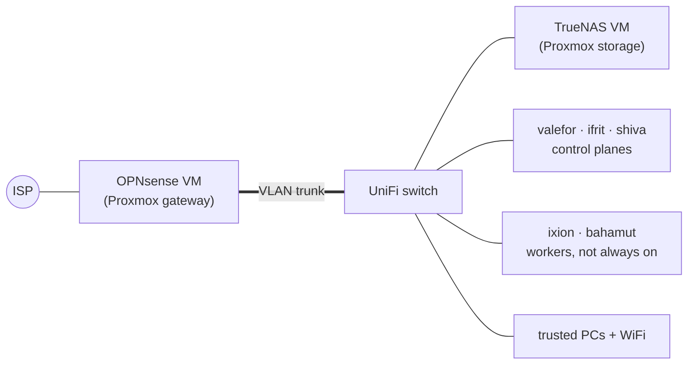

# Homelab

Infrastructure as code for a small bare-metal homelab: an OPNsense router and
a TrueNAS storage VM on two Proxmox mini-PCs, and a five-node Talos
Kubernetes cluster (`workload-prd`) managed by Flux. Everything that can be
declared lives here; the few manual steps are written down next to the code
they belong to.

| | |
|---|---|
| Kubernetes | Talos v1.14.2, Kubernetes v1.37.1, Cilium 1.20.1, Flux 2.9.4 |
| Nodes | 3 control planes (valefor, ifrit, shiva) + 2 workers (ixion, bahamut) |
| Network | OPNsense: VLANs 3 storage / 4 k8s-workload / 5 trusted, BGP to Cilium, HAProxy API VIP |
| Storage | Longhorn on the nodes, TrueNAS over NFS and iSCSI, RustFS S3 for object storage |
| Domain | `yuriykovalchuk.dev` (Cloudflare DNS, Let's Encrypt, Cloudflare Tunnel) |

## Documentation

| File | Contents |
|------|----------|
| [docs/NETWORK.md](docs/NETWORK.md) | Topology diagram, VLANs, switch ports, firewall, DNS, API VIP, BGP |
| [docs/DEVICES.md](docs/DEVICES.md) | Every device: hardware, IPs, MACs, GPUs, Talos schematics |
| [CLAUDE.md](CLAUDE.md) | Working notes for AI assistants: conventions and pitfalls |

## Infrastructure at a glance



- **Control planes** are small HP mini-PCs. They run etcd, the platform and
  everything that must stay up. Longhorn data that has to survive a worker
  being off is kept on them only (node tag `system`).
- **Workers** are switched off at times. **bahamut** carries an AMD Radeon AI
  PRO R9700 over OCuLink plus a Radeon 780M and runs the local LLM stack;
  it is tainted `workload=gpu:NoSchedule`. **ixion** has a Radeon 680M used
  by Immich.
- **TrueNAS** serves NFS/iSCSI volumes to the cluster and runs Vault, Harbor,
  RustFS (S3), Traefik and Dockhand as TrueNAS apps.

Full detail: [docs/NETWORK.md](docs/NETWORK.md), [docs/DEVICES.md](docs/DEVICES.md).

## Repository layout

```
Homelab/
├── kubernetes/
│   ├── clusters/workload-prd/
│   │   ├── flux-system/      Flux Kustomizations: one file per layer, plus their order
│   │   └── terraform/        Bootstrap: cni (Cilium), fluxcd, vault (app secrets), cloudflare
│   ├── namespaces/           Every Namespace, one file per component
│   ├── network-policies/     Every CiliumNetworkPolicy, one file per component + cluster-wide/
│   ├── core/                 CRDs and engines: Gateway API, prometheus-operator CRDs, cert-manager, external-secrets, Kyverno
│   ├── policies/             Kyverno PolicyExceptions and mutating/generating policies
│   ├── secrets/              ClusterSecretStore + every ExternalSecret
│   ├── platform/
│   │   ├── infra/            What other layers need: gateway, BGP, storage, CNPG, KubeVirt, GPU DRA driver
│   │   └── ops/              Day-2 tooling: Trivy, VPA/Goldilocks, cloudflared, Hubble UI, cleanup jobs
│   ├── observability/        Loki, Mimir, Tempo, Alloy, Grafana, Alertmanager, talos-monitoring
│   │   └── alerting-rules/   PrometheusRules
│   ├── apps/                 User-facing apps
│   ├── llm/                  llama.cpp, Strata, stable-diffusion, Open WebUI (wired in through apps)
│   └── vms/                  KubeVirt VMs
├── proxmox-nodes/
│   ├── terraform/            Terragrunt: OPNsense VM, TrueNAS VM, TrueNAS datasets and apps, Proxmox ACME
│   └── ansible/              OPNsense configuration (VLANs, DHCP, firewall, DNS, BGP, HAProxy) and the Docker VM
├── netbox/                homelab.yaml (devices, cabling, VLANs, IPs, VMs) + sync.py that loads it into NetBox
├── docs/
├── devbox.json               Pinned CLI tooling
└── devbox_scripts/
```

Components follow one shape: `component/base/` holds the workload (usually a
HelmRepository + HelmRelease), `component/overlays/workload-prd/` holds the
cluster-specific patches and HTTPRoute. Namespaces, network policies,
ExternalSecrets and PolicyExceptions are **not** kept with the component;
they live in the four central folders above.

## GitOps

Flux syncs branch `main`. Each top-level folder is its own Flux
Kustomization, ordered by `dependsOn`:

```
namespaces
└── network-policies
    └── core
        ├── policies
        └── secrets
            └── platform-infra          (also depends on policies)
                ├── platform-ops
                ├── observability
                │   └── alerting-rules
                ├── apps                (also depends on policies)
                └── vm-ubuntu-test
```

Why it is split this way:

- A Kustomization that installs CRDs through a HelmRelease must never also
  apply instances of those CRDs: Flux applies the instances before the chart
  has installed the CRDs, and the cold start fails. That is why network
  policies, secrets and policies are separate layers after `core`.
- `platform-infra` holds only what other layers need to work; a broken tool
  in `platform-ops` cannot block anything else.
- The `apps` Kustomization ignores `/spec/replicas` for Deployments in the
  `llm` namespace, so GPU workloads can be parked at 0 with `kubectl scale`.

## Components

Chart versions as deployed.

**core**

| Component | Version | Purpose |
|-----------|---------|---------|
| Gateway API CRDs | — | Gateway/HTTPRoute/TCPRoute types |
| prometheus-operator-crds | 32.0.1 | ServiceMonitor/PodMonitor/PrometheusRule types |
| cert-manager | v1.21.2 | Let's Encrypt certificates via Cloudflare DNS-01 |
| external-secrets | 2.11.0 | Vault → Kubernetes Secrets |
| Kyverno (+ kyverno-policies) | 3.9.1 | Admission policies, baseline Pod Security |

**platform-infra**

| Component | Version | Purpose |
|-----------|---------|---------|
| gateway | — | Cilium Gateway `internal` with one HTTPS listener per hostname |
| cluster-issuer | — | `letsencrypt-dns` ClusterIssuer |
| bgp | — | Cilium BGP peering with OPNsense + LoadBalancer IP pool |
| Longhorn | 1.13.0 | Replicated block storage on the nodes |
| democratic-csi (nfs, iscsi) | 0.15.1 | TrueNAS volumes |
| CloudNativePG | 0.29.1 | Postgres operator; one cluster per app |
| KubeVirt + CDI | — | Virtual machines and disk import |
| metrics-server | 3.14.0 | Resource metrics for VPA/HPA |
| k8s-gpu-dra-driver | v1.0.1 | AMD GPUs as DRA devices (`gpu.amd.com`) |

**platform-ops**

| Component | Version | Purpose |
|-----------|---------|---------|
| VPA + Goldilocks | 5.1.0 / 11.2.0 | Resource recommendations |
| Trivy operator + PolicyReport adapter | 0.36.0 / 0.11.5 | Vulnerability scanning |
| policy-reporter | 3.10.0 | Kyverno report UI |
| cloudflared | — | Cloudflare Tunnel for public access |
| yk-dns-manager | 0.1.1-dev | Writes internal DNS records into OPNsense |
| hubble, cilium-observability, flux-system | — | Hubble UI, Envoy stats, Flux UI routes |
| clean-pods | — | CronJob removing failed and stale pods |

**observability**

| Component | Version | Purpose |
|-----------|---------|---------|
| Mimir (mimir-distributed) | 6.2.0 | Metrics, ruler |
| Loki | 7.3.0 | Logs |
| Tempo (tempo-distributed) | 2.23.4 | Traces |
| k8s-monitoring (Alloy) | 4.5.2 | Collectors for metrics, logs, traces |
| Grafana | 10.5.15 | Dashboards |
| Alertmanager | 2.0.1 | Alerts to Slack |
| talos-monitoring | 0.1.0 | Talos node monitoring |

Mimir, Loki and Tempo store data in RustFS (S3 on TrueNAS). Mimir and Tempo
ingesters are spread one per node; Loki's are not yet.

**apps**

| App | Purpose |
|-----|---------|
| immich | Photos; Radeon 680M on ixion via a shared DRA claim; CNPG Postgres |
| opencloud | File cloud |
| forgejo + forgejo-runner | Git server (CNPG Postgres) and Actions runner (builds on bahamut) |
| homepage | Dashboard |
| netbox | Inventory and IPAM for the lab (experiment; CNPG Postgres, Valkey) |
| yk-portfolio, yk-update-checker | Personal site, dependency update dashboard |
| httpbin, whoami | Test services |
| llama-cpp, llama-cpp-rocm, llama-cpp-igpu | llama.cpp servers on the R9700 (Vulkan, ROCm) and the 780M |
| strata | Expert-caching inference engine on the R9700 |
| sd-server | stable-diffusion.cpp on the R9700 (parked at 0 by default) |
| open-webui | Chat UI for the llama.cpp servers |

Only one R9700 workload can run at a time: GPU claims are exclusive.

**In the tree but not deployed:** `core/local-path-provisioner`,
`platform/yk-talos-manager`, `llm/llama-cpp-cuda`.

## Storage classes

| Class | Backend | Use |
|-------|---------|-----|
| `longhorn` (default) | Longhorn, 3 replicas on `system` nodes | General persistent data |
| `longhorn-1r` | Longhorn, 1 replica, best-effort locality, `system` nodes | Data the app already replicates: Mimir, Loki, Tempo, Alertmanager |
| `longhorn-gpu` | Longhorn, 1 replica, strict-local, `gpu` nodes | Model weights on bahamut |
| `longhorn-static` | Longhorn | Pre-created volumes |
| `truenas-nfs` | TrueNAS NFS | Shared (RWX) data |
| `truenas-iscsi` | TrueNAS iSCSI | Block (RWO) data on the NAS: Forgejo, OpenCloud, Immich, the runner's Docker cache |

## Secrets

Values are `TF_VAR_*` variables in an untracked `.env`. Terraform
(`kubernetes/clusters/workload-prd/terraform/vault/`) writes them to Vault
(KV v2 mount `kubernetes`, running on TrueNAS); External Secrets turns them
into Kubernetes Secrets through the `default-store` ClusterSecretStore,
which authenticates with Vault's Kubernetes auth method. Nothing secret is
committed.

## Tooling

`devbox shell` gives the pinned CLIs (kubectl, helm, talosctl, flux, cilium,
hubble, terraform, terragrunt, aws) and loads `.env`.

| Task | Where |
|------|-------|
| Change a cluster component | Edit under `kubernetes/`, push; Flux applies it |
| Configure OPNsense | `ansible-playbook -i inventories/prd/gateway playbooks/opnsense/<playbook>.yml` from `proxmox-nodes/ansible` |
| Proxmox VMs, TrueNAS datasets/apps | `terragrunt apply` under `proxmox-nodes/terraform/prd/...` (state in RustFS) |
| Cilium, Flux bootstrap, Vault secrets, Cloudflare | Terraform under `kubernetes/clusters/workload-prd/terraform/` |
| Talos nodes | `talosctl` with configs kept outside the repo; always pass the node's factory installer image (`-i`) on upgrade |
