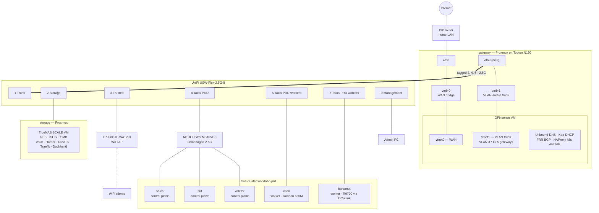

# Network

How the homelab is wired and how traffic moves through it. Every IP, MAC and
hardware detail lives in [DEVICES.md](DEVICES.md); this file covers the
topology, VLANs, switch ports, firewall policy and routing.

## Topology

- **One router.** OPNsense routes between every VLAN and to the internet;
  the switch does only port-based VLAN tagging (networks are "VLAN Only" in
  UniFi). Its WAN sits on the home LAN behind the ISP router (double NAT).
- **One trunk.** Proxmox `eth3` → `vmbr1` → OPNsense `vtnet1` carries VLANs 3,
  4 and 5 tagged to switch port 1. Everything below the switch is an untagged
  access port.
- **The Proxmox gateway host's own management** is on the home LAN, not a
  VLAN. Home-LAN devices reach it without passing OPNsense.

## VLANs

The VLAN ID is the third octet of the subnet (VLAN 4 → `10.0.4.0/24`). VLAN 1
is unused. Supernet `10.0.0.0/16` (`HOMELAB_ALL` in the firewall).

| VLAN | UniFi name | OPNsense interface | Purpose |
|------|-----------|--------------------|---------|
| 3 | `Storage` | opt2 — Storage | Storage node and TrueNAS (NFS/iSCSI, Vault, Harbor, RustFS) |
| 4 | `Talos PRD` | opt3 — K8sWorkload | Talos nodes, Kubernetes API VIP, Cilium LoadBalancer pool |
| 5 | `Trusted` | opt4 — PhysWorkload | Trusted PCs and WiFi clients; also the switch's own management |

The names differ between systems: VLAN 4 is "Talos PRD" in UniFi and
`k8s-workload` in OPNsense and the Ansible playbooks; VLAN 5 is "Trusted" in
UniFi and still carries its older description `phys-workload` in OPNsense.
This doc calls them storage, k8s-workload and trusted. VLANs 2, 6 and 7 were
removed on 2026-10-10. An untrusted / guest network is planned but does not
exist yet.

Each VLAN gets DHCP from OPNsense Kea (pool `.100–.200`), with OPNsense as
gateway, DNS and NTP. Static leases are Kea reservations
(`proxmox-nodes/ansible/playbooks/opnsense/reservations.yml`).

## Switch ports

UniFi USW-Flex-2.5G-8. It is managed from the UniFi controller; its
**Device Management Network** is Trusted (VLAN 5). If the switch loses its
management network it keeps forwarding with the last pushed config but drops
off the controller; recover by plugging into a port still on the `Default`
network (7, 8 or 10).

| Port | UniFi name | Connected to | Link | Native VLAN | Tagged VLANs |
|------|-----------|--------------|------|-------------|--------------|
| 1 | Trunk | gateway Proxmox `eth3` → OPNsense vtnet1 | 2.5 GbE | None | Storage (3), Talos PRD (4), Trusted (5) |
| 2 | Storage | storage Proxmox host (TrueNAS VM behind it) | 2.5 GbE | Storage (3) | Block All |
| 3 | Trusted | TP-Link TL-WA1201 access point | 1 GbE | Trusted (5) | Block All |
| 4 | Talos PRD | MERCUSYS MS105GS → valefor, ifrit, shiva | 2.5 GbE | Talos PRD (4) | Block All |
| 5 | Talos PRD workers | ixion | — (offline) | Talos PRD (4) | Block All |
| 6 | Talos PRD workers | bahamut | 2.5 GbE | Talos PRD (4) | Block All |
| 7 | Port 7 | — | — | Default | — |
| 8 | Port 8 | — | — | Default | — |
| 9 | Management | admin PC | — | Trusted (5) | Block All |
| 10 | Port 10 (SFP) | — | — | Default | — |

Ports 7, 8 and 10 are untouched factory defaults: untagged `Default`
network, which OPNsense does not serve. The AP does no VLAN tagging; its
single SSID is the trusted network. valefor and shiva have 1 GbE NICs, so
only ifrit runs at 2.5 GbE behind the MERCUSYS switch.

## Firewall

Managed by `proxmox-nodes/ansible/playbooks/opnsense/firewall.yml`, `dns.yml`
and `proxmox.yml`. OPNsense blocks by default; these are the pass rules.

| Interface | Rule | Allows |
|-----------|------|--------|
| WAN | wan-01 | home LAN → OPNsense web/API (443) |
| WAN | wan-02 | **block** any → Proxmox gateway SSH/web UI (22, 8006) |
| WAN | dns | **block** port 53 leaving through WAN (DNS can only go out over DoT) |
| storage (opt2) | opt2-05 | → OPNsense DNS |
| storage (opt2) | opt2-08 / 10 | → internet: DNS, HTTP/HTTPS only |
| storage (opt2) | opt2-15 | → k8s-workload 6443 (Vault's TokenReview calls to the k8s API) |
| k8s-workload (opt3) | opt3-05 – 08 | → OPNsense DNS, NTP, HTTPS API (yk-dns-manager), BGP |
| k8s-workload (opt3) | opt3-09 | → Kubernetes API VIP 6443 |
| k8s-workload (opt3) | opt3-10 | → storage, all ports |
| k8s-workload (opt3) | opt3-30 | → internet |
| trusted (opt4) | opt4-10 | → every homelab VLAN |
| trusted (opt4) | opt4-20 | → internet |
| trusted (opt4) | proxmox | → Proxmox gateway SSH/web UI |

In short: **trusted** can reach everything; **k8s-workload** reaches storage,
the internet and the gateway services it needs; **storage** only answers,
except for internet updates and Vault calling the Kubernetes API.

## DNS

- **Resolver:** Unbound on OPNsense, forwarding over DNS-over-TLS to
  Cloudflare (1.1.1.1 / 1.0.0.1).
- **Forced:** each VLAN has a destination-NAT rule that rewrites any port-53
  query to an outside resolver back to Unbound, and WAN blocks port 53, so a
  client with a hard-coded DNS server is still answered locally.
- **Domain:** `yuriykovalchuk.dev` is hosted on Cloudflare. Internal records
  for cluster services (all pointing at the `internal` Gateway) are written
  into Unbound by `yk-dns-manager` through the OPNsense API.

## Kubernetes API VIP

`k8s_api_lb.yml` puts an IP alias on the k8s-workload interface and runs
HAProxy on OPNsense in TCP passthrough to the three control planes (TLS is
end to end; the VIP is in each API server's certificate via Talos
`cluster.apiServer.certSANs`). kubeconfig and the Talos
`cluster.controlPlane.endpoint` point at the VIP, so losing one control plane
does not cut off `kubectl`.

HAProxy health-checks each API server with HTTPS `GET /readyz` every 2s and
accepts `200` or `401` (Talos disables anonymous auth, so a healthy server
answers `401`). A TCP-only check is not enough: a starved apiserver still
completes the TCP handshake but never answers TLS.

Inside the cluster, nodes reach the API through Talos KubePrism
(`localhost:7445`), which does not depend on the VIP.

## BGP and LoadBalancer IPs

Cilium's BGP control plane on **every** node (ASN 65002) peers with FRR on
OPNsense (ASN 65551, router ID = the k8s-workload gateway). Cilium advertises
LoadBalancer service IPs from the pool in the k8s-workload subnet; OPNsense
installs them as routes to the node holding each service.

- OPNsense side: `proxmox-nodes/ansible/playbooks/opnsense/bgp.yml` (one
  neighbor per node, matched by IP).
- Cilium side: `kubernetes/platform/infra/bgp/`.
- The `internal` Gateway (all HTTPS hostnames) has a fixed IP from the pool.

## Exposure

- **Internal:** every app is an HTTPS listener on the Cilium Gateway
  `internal`, with a Let's Encrypt certificate (DNS-01 via Cloudflare) and an
  internal DNS record. Reachable from trusted and k8s-workload.
- **Public:** `cloudflared` runs a Cloudflare Tunnel from the cluster. Nothing
  needs to be port-forwarded for it.

## OPNsense configuration

Mostly Ansible (`proxmox-nodes/ansible/playbooks/opnsense/`, run against
`inventories/prd/gateway`). Order of `site.yml`:

1. `vlans.yml` — VLAN sub-interfaces on vtnet1.
2. `interfaces.yml` — prints the manual GUI steps (OPNsense has no API for
   interface assignment or IPs).
3. `dhcp.yml` — Kea subnets and pools.
4. `nat.yml` — checks outbound NAT is Automatic.
5. `firewall.yml` — aliases and rules.
6. `dns.yml` — Unbound DoT, DNS redirect, WAN port-53 block.
7. `proxmox.yml` — Proxmox management access.

Run separately: `reservations.yml` (static leases), `bgp.yml` (FRR),
`k8s_api_lb.yml` (HAProxy VIP).

The modules need `httpx` in the Python Ansible runs with, and the
`OPNSENSE_*` variables from `.env`. With `oxlorg.opnsense` 26.x, read live
state back after changes: some modules report success without saving, and
`dhcp_subnet` blanks DNS/NTP servers unless they are passed explicitly.
