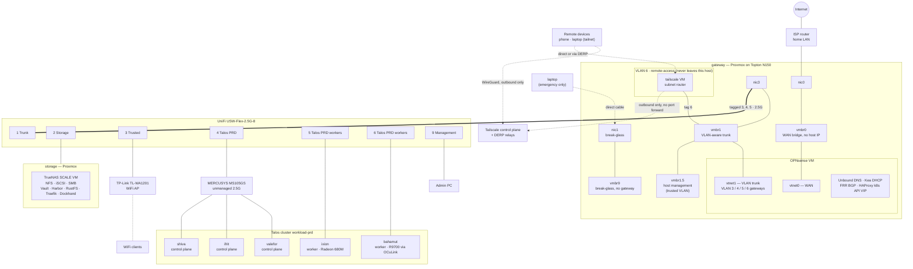

# Network

How the homelab is wired and how traffic moves through it. Every IP, MAC and
hardware detail lives in [DEVICES.md](DEVICES.md); this file covers the
topology, VLANs, switch ports, firewall policy, remote access and routing.

## Topology

- **One router.** OPNsense routes between every VLAN and to the internet;
  the switch does only port-based VLAN tagging (networks are "VLAN Only" in
  UniFi). Its WAN sits on the home LAN behind the ISP router (double NAT).
- **One trunk.** Proxmox `eth3` → `vmbr1` → OPNsense `vtnet1` carries VLANs 3,
  4 and 5 tagged to switch port 1. Everything below the switch is an untagged
  access port.
- **VLAN 6 exists only inside the gateway host.** The Tailscale VM and
  OPNsense's `vtnet1` share `vmbr1`, so remote-access traffic never touches the
  switch, and always passes OPNsense's firewall.
- **The gateway host's management is on the trusted VLAN** (`vmbr1.5`), not
  on the home LAN. Home-LAN devices cannot reach it; trusted PCs reach it at
  L2, so it works even with OPNsense down. A spare NIC (`nic1`) is a
  break-glass port for a direct laptop cable.

## VLANs

The VLAN ID is the third octet of the subnet (VLAN 4 → `10.0.4.0/24`). VLAN 1
is unused. Supernet `10.0.0.0/16` (`HOMELAB_ALL` in the firewall).

| VLAN | UniFi name | OPNsense interface | Purpose |
|------|-----------|--------------------|---------|
| 3 | `Storage` | opt2 — Storage | Storage node and TrueNAS (NFS/iSCSI, Vault, Harbor, RustFS) |
| 4 | `Talos PRD` | opt3 — K8sWorkload | Talos nodes, Kubernetes API VIP, Cilium LoadBalancer pool |
| 5 | `Trusted` | opt4 — PhysWorkload | Trusted PCs and WiFi clients; also the switch's own management |
| 6 | — (not on the switch) | opt1 — Tailscale | Remote access: the Tailscale subnet router VM only |

The names differ between systems: VLAN 4 is "Talos PRD" in UniFi and
`k8s-workload` in OPNsense and the Ansible playbooks; VLAN 5 is "Trusted" in
UniFi and still carries its older description `phys-workload` in OPNsense;
VLAN 6 is `remote-access` in Ansible and "Tailscale" in the OPNsense GUI.
This doc calls them storage, k8s-workload, trusted and remote-access. The old
VLANs 2, 6 (private wifi) and 7 were removed on 2026-10-10; VLAN 6 was reused
for remote access on 2026-10-11. An untrusted / guest network is planned but
does not exist yet.

VLANs 3–5 get DHCP from OPNsense Kea (pool `.100–.200`), with OPNsense as
gateway, DNS and NTP. Static leases are Kea reservations
(`proxmox-nodes/ansible/playbooks/opnsense/reservations.yml`). VLAN 6 has no
DHCP: its one VM has a static address from cloud-init.

## Switch ports

UniFi USW-Flex-2.5G-8. It is managed from the UniFi controller; its
**Device Management Network** is Trusted (VLAN 5). If the switch loses its
management network it keeps forwarding with the last pushed config but drops
off the controller; recover by plugging into a port still on the `Default`
network (7, 8 or 10).

| Port | UniFi name | Connected to | Link | Native VLAN | Tagged VLANs |
|------|-----------|--------------|------|-------------|--------------|
| 1 | Trunk | gateway Proxmox `eth3` → OPNsense vtnet1 | 2.5 GbE | None | Storage (3), Talos PRD (4), Trusted (5) |
| 2 | Storage | storage Proxmox host (TrueNAS VM behind it) | 2.5 GbE | Storage (3) | Block All |
| 3 | Trusted | TP-Link TL-WA1201 access point | 1 GbE | Trusted (5) | Block All |
| 4 | Talos PRD | MERCUSYS MS105GS → valefor, ifrit, shiva | 2.5 GbE | Talos PRD (4) | Block All |
| 5 | Talos PRD workers | ixion | — (offline) | Talos PRD (4) | Block All |
| 6 | Talos PRD workers | bahamut | 2.5 GbE | Talos PRD (4) | Block All |
| 7 | Port 7 | — | — | Default | — |
| 8 | Port 8 | — | — | Default | — |
| 9 | Management | admin PC | — | Trusted (5) | Block All |
| 10 | Port 10 (SFP) | — | — | Default | — |

Ports 7, 8 and 10 are untouched factory defaults: untagged `Default`
network, which OPNsense does not serve. The AP does no VLAN tagging; its
single SSID is the trusted network. valefor and shiva have 1 GbE NICs, so
only ifrit runs at 2.5 GbE behind the MERCUSYS switch. VLAN 6 is not on the
trunk: it never leaves the gateway host.

## Firewall

Managed by `proxmox-nodes/ansible/playbooks/opnsense/firewall.yml`, `dns.yml`
and `proxmox.yml`. OPNsense blocks by default; rules are evaluated in
sequence order per interface.

| Interface | Rule | Action |
|-----------|------|--------|
| WAN | wan-01 | home LAN → OPNsense web/API (443) — **targets the old WAN address `.110`, see DEVICES.md** |
| WAN | dns | **block** port 53 leaving through WAN (DNS only leaves over DoT) |
| storage (opt2) | opt2-05 | → OPNsense DNS |
| storage (opt2) | opt2-08 / 10 | → internet: DNS, HTTP/HTTPS only |
| storage (opt2) | opt2-15 | → k8s-workload 6443 (Vault's TokenReview calls to the k8s API) |
| k8s-workload (opt3) | opt3-05 – 08 | → OPNsense DNS, NTP, HTTPS API (yk-dns-manager), BGP |
| k8s-workload (opt3) | opt3-09 | → Kubernetes API VIP 6443 |
| k8s-workload (opt3) | opt3-10 | → storage, all ports |
| k8s-workload (opt3) | opt3-30 | → internet |
| trusted (opt4) | opt4-10 | → every homelab VLAN, incl. remote-access (SSH to the Tailscale VM) |
| trusted (opt4) | opt4-20 | → internet |
| remote-access (opt1) | opt1-05 / 06 | → OPNsense DNS, NTP |
| remote-access (opt1) | opt1-10 | → every homelab VLAN, all ports, incl. the gateway Proxmox on trusted (full admin; the tailnet policy decides who) |
| remote-access (opt1) | opt1-18 | **block** → rest of the home LAN (`192.168.0.0/16`, `172.16.0.0/12`) |
| remote-access (opt1) | opt1-20 | → internet TCP 80/443 (Tailscale control, DERP relays, apt) |
| remote-access (opt1) | opt1-21 | → internet UDP 41641/3478 (Tailscale direct WireGuard, STUN) |

In short: **trusted** can reach everything; **remote-access** reaches the
whole lab (incl. both Proxmox hosts), but not the home LAN, and the
internet only for Tailscale and updates; **k8s-workload** reaches storage, the
internet and the gateway services it needs; **storage** only answers, except
for internet updates and Vault calling the Kubernetes API. Nothing may open
connections into remote-access except trusted.

**Host-type aliases are only filled by an alias reconfigure.** A rule reload
alone leaves their table empty, and every rule using them then silently
matches nothing. `firewall.yml` reconfigures aliases before reloading rules.

**Gap still open:** k8s-workload's internet rule (`opt3-30`, "not homelab")
also matches the home LAN, so pods can reach the ISP router and other home
devices. The same block as `opt1-18` would close it.

Inside Kubernetes, Cilium only lets clients from outside the cluster reach
the `internal` Gateway (80/443) from the trusted VLAN and from the Tailscale
VM's address (`allow-gateway-frontend`, `allow-kube-system`). App policies
trust the Gateway, so they don't need changes for new client networks.

## Gateway host management

The gateway Proxmox host runs OPNsense, so its own management must not depend
on the network it hosts more than necessary.

| Path | Address | Works when |
|------|---------|-----------|
| Trusted VLAN (normal) | `https://10.0.5.3:8006` | Switch and trunk up; OPNsense not needed (same L2 as trusted PCs) |
| Tailscale | same address, via the subnet router | OPNsense up |
| Break-glass | `https://172.30.0.1:8006`, laptop `172.30.0.2/24` on a cable into `nic1` | Host up — nothing else needed |
| Physical console | keyboard and monitor | Always |

Managed by `proxmox-nodes/terraform/prd/gateway/network` with a `lockdown`
switch: `false` puts the management address back on the home LAN
(`192.168.0.254`, gateway the ISP router) for a rebuild, `true` is normal
operation (no host address on `vmbr0`, default route via OPNsense). Switch it
only from a path that survives the change (trusted or break-glass), and point
`GATEWAY_PROXMOX_ENDPOINT` at the address that will still exist afterwards.

## Remote access (Tailscale)

A Tailscale **subnet router** VM on VLAN 6 lets your tailnet devices reach the
lab from anywhere. It connects out to Tailscale; nothing is port-forwarded on
the ISP router or OPNsense. Traffic is WireGuard end to end, direct when NAT
traversal works, otherwise through a DERP relay (nearest: Frankfurt).

**Two layers decide what a remote device reaches:**

1. **Tailnet policy** — `proxmox-nodes/terraform/_modules/tailscale-tailnet/policy.hujson`,
   applied by Terraform. Only tailnet admins (you) reach the advertised
   routes; the router tag may start no connection to any tailnet device;
   route auto-approval accepts exactly the advertised prefixes.
2. **OPNsense rules on opt1** (table above). The VM SNATs remote traffic, so
   the lab sees every remote client as the VM's address.

**Advertised routes:** storage, k8s-workload and trusted subnets (the trusted
one includes the gateway Proxmox) and OPNsense's VLAN 6 address (the
split-DNS resolver). Split DNS
sends `yuriykovalchuk.dev` to Unbound on VLAN 6, so app hostnames resolve to
the Gateway exactly as at home.

**Tailnet settings (Terraform):** device and user approval on, auto-updates on,
device keys valid 180 days, policy marked as managed in Git. MFA is enforced
by the identity provider (Apple ID). Tailnet Lock is not enabled yet.

**Known limitation:** OPNsense's outbound NAT randomises source ports
(`MappingVariesByDestIP: true` in `tailscale netcheck`), so many clients use
the relay. A static-port outbound NAT rule for the VM's UDP 41641 (Hybrid NAT
mode) would make direct connections more likely.

**Threat model:** a compromised VM gets the network reach in the table above
— every admin surface in the lab — but no credentials. Defences beyond the
firewall are mutual TLS on kubectl/talosctl and passwords on the
web UIs (2FA on Proxmox, OPNsense and TrueNAS is recommended). The VM shares its hypervisor with OPNsense; moving it to separate
hardware would remove that risk.

| Piece | Where |
|-------|-------|
| VM | `proxmox-nodes/terraform/prd/gateway/tailscale` (module `_modules/tailscale-vm`) |
| Tailnet policy, split DNS, settings, router auth key | `proxmox-nodes/terraform/prd/tailscale` (module `_modules/tailscale-tailnet`), OAuth client credentials in `.env` |
| The OAuth client itself | `proxmox-nodes/terraform/prd/tailscale-bootstrap` — applied only with a short-lived `TAILSCALE_API_KEY` |
| VM configuration (Tailscale, forwarding, updates, NTP) | `proxmox-nodes/ansible/playbooks/tailscale.yml`, inventory `inventories/prd/remote-access` |
| OPNsense rules | `firewall.yml` (opt1-*), `dns.yml` (redirect) |

## DNS

- **Resolver:** Unbound on OPNsense, forwarding over DNS-over-TLS to
  Cloudflare (1.1.1.1 / 1.0.0.1).
- **Forced:** each VLAN has a destination-NAT rule that rewrites any port-53
  query to an outside resolver back to Unbound, and WAN blocks port 53, so a
  client with a hard-coded DNS server is still answered locally.
- **Blocklists:** Unbound's DNSBL has the HaGeZi, OISD, AdGuard and other
  lists enabled (chosen in the GUI). HaGeZi's "DoH/VPN/TOR/Proxy Bypass" list
  blocks Tailscale, so `dns.yml` allowlists `tailscale.com`, `tailscale.io`
  and their subdomains. Applying the blocklist re-downloads every list:
  Unbound answers nothing for about a minute.
- **Domain:** `yuriykovalchuk.dev` is hosted on Cloudflare. Internal records
  for cluster services (all pointing at the `internal` Gateway) are written
  into Unbound by `yk-dns-manager` through the OPNsense API.

## Kubernetes API VIP

`k8s_api_lb.yml` puts an IP alias on the k8s-workload interface and runs
HAProxy on OPNsense in TCP passthrough to the three control planes (TLS is
end to end; the VIP is in each API server's certificate via Talos
`cluster.apiServer.certSANs`). kubeconfig and the Talos
`cluster.controlPlane.endpoint` point at the VIP, so losing one control plane
does not cut off `kubectl`.

HAProxy health-checks each API server with HTTPS `GET /readyz` every 2s and
accepts `200` or `401` (Talos disables anonymous auth, so a healthy server
answers `401`). A TCP-only check is not enough: a starved apiserver still
completes the TCP handshake but never answers TLS.

Inside the cluster, nodes reach the API through Talos KubePrism
(`localhost:7445`), which does not depend on the VIP.

## BGP and LoadBalancer IPs

Cilium's BGP control plane on **every** node (ASN 65002) peers with FRR on
OPNsense (ASN 65551, router ID = the k8s-workload gateway). Cilium advertises
LoadBalancer service IPs from the pool in the k8s-workload subnet; OPNsense
installs them as routes to the node holding each service.

- OPNsense side: `proxmox-nodes/ansible/playbooks/opnsense/bgp.yml` (one
  neighbor per node, matched by IP).
- Cilium side: `kubernetes/platform/infra/bgp/`.
- The `internal` Gateway (all HTTPS hostnames) has a fixed IP from the pool.

## Exposure

- **Internal:** every app is an HTTPS listener on the Cilium Gateway
  `internal`, with a Let's Encrypt certificate (DNS-01 via Cloudflare) and an
  internal DNS record. Reachable from trusted, from k8s-workload, and from
  tailnet devices through the Tailscale VM.
- **Public:** `cloudflared` runs a Cloudflare Tunnel from the cluster. Nothing
  needs to be port-forwarded for it.

## OPNsense configuration

Mostly Ansible (`proxmox-nodes/ansible/playbooks/opnsense/`, run against
`inventories/prd/gateway`). Order of `site.yml`:

1. `vlans.yml` — VLAN sub-interfaces on vtnet1.
2. `interfaces.yml` — prints the manual GUI steps (OPNsense has no API for
   interface assignment or IPs).
3. `dhcp.yml` — Kea subnets and pools.
4. `nat.yml` — checks outbound NAT is Automatic.
5. `firewall.yml` — aliases and rules.
6. `dns.yml` — Unbound DoT, DNSBL allowlist, DNS redirect, WAN port-53 block.
Run separately: `reservations.yml` (static leases), `bgp.yml` (FRR),
`k8s_api_lb.yml` (HAProxy VIP). The Tailscale VM itself is configured by
`playbooks/tailscale.yml` against `inventories/prd/remote-access`.

The modules need `httpx` in the Python Ansible runs with, and the
`OPNSENSE_*` variables from `.env`. With `oxlorg.opnsense` 26.x, read live
state back after changes: some modules report success without saving,
`dhcp_subnet` blanks DNS/NTP servers unless they are passed explicitly, and
long operations (DNSBL apply) need a raised `timeout`.
